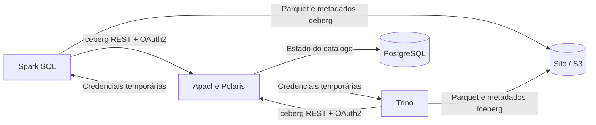

# Arquitetura da demonstração

## Responsabilidades

| Componente | Papel |
|---|---|
| Spark | Cria a tabela e o primeiro snapshot |
| Trino | Descobre a tabela, consulta e efetua um novo commit |
| Polaris | Resolve namespaces/tabelas, autentica clientes e coordena commits |
| Silo | Armazena arquivos Parquet e metadados Iceberg pela API S3 |

O laboratório usa armazenamento S3 compatível para garantir que os dois engines acessem os mesmos objetos. O estado interno do Polaris é persistido no PostgreSQL; a demonstração ainda não representa uma implantação de produção.
